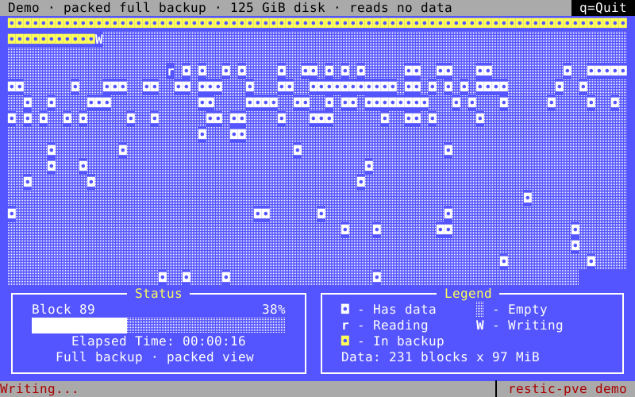
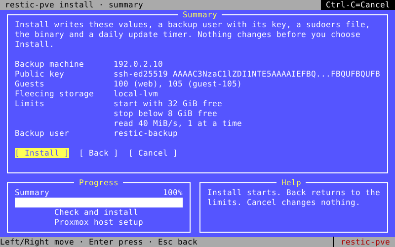
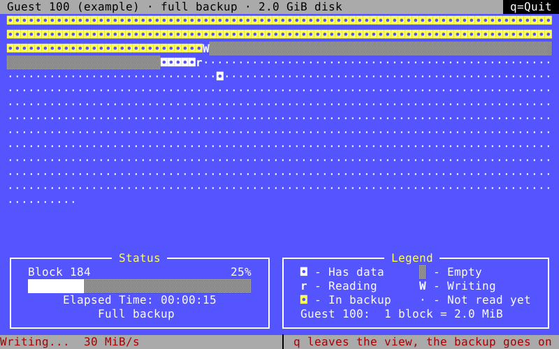
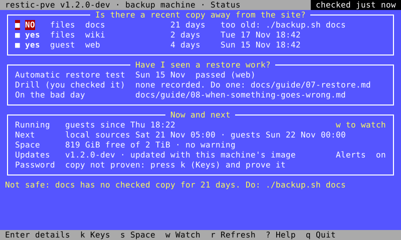
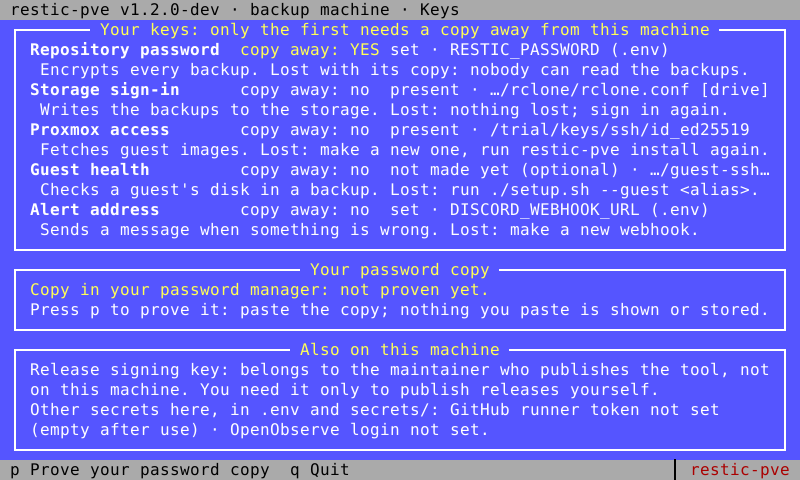

# restic-pve

`restic-pve` is one static binary that lets a separate backup machine copy the virtual machines
of a Proxmox VE host offsite, encrypted with restic. It exists because backups are daunting, and
ransomware is scary for exactly that reason: this tool tries to make each backup job a few steps
you can follow and check.



The block view halfway through a demo run (`restic-pve demo pack`, made-up disk, reads no data).

This repository is the tool. On the Proxmox host it is complete: install, hand out guest images,
update itself, uninstall. On the backup machine it provides the `stream`, `watch`, `status`,
`keys` and `space` commands. Everything else on the backup machine (the schedule, the calls to
restic and rclone, the setup) is still done by control code that is not published. Making the
backup machine installable from this repository alone is the next stage. You cannot set up a
complete offsite backup from this repository today.

## Is this for you?

It fits if:

- you run Proxmox VE 8.2 or newer (vzdump with fleecing) on linux/amd64, and want offsite copies
  of its QEMU virtual machines;
- you have, or will have, a separate Linux machine that does the backups;
- you want to read every file the tool puts on the hypervisor, and remove it with one command.

It is not for you (yet) if:

- you need a backup machine you can install from here today (see [State and roadmap](#state-and-roadmap));
- you back up LXC containers: the host side offers only guests from `qm list`;
- you need arm64, or a storage other than Google Drive with a guided setup (Google Drive is the
  only tested storage);
- you need changed-block reads: every guest backup reads the whole disk, and restic
  deduplicates what did not change;
- one backup machine has to serve several Proxmox hosts.

It does not replace or touch an existing vzdump job or Proxmox Backup Server. On the host it adds
one restricted backup user and the few files listed in [docs/host.md](docs/host.md).

## What you get

1. Offsite backups. Guest images end up in a restic repository on Google Drive, through rclone,
   encrypted by restic. On the backup machine, `restic-pve status` says whether every source and
   guest has a recent checked copy away from the site.
2. Performance. The host side and the stream reader are native Go. Running guests are read with
   Proxmox's own vzdump and fleecing, so they keep their speed while they are copied. The stream
   puts each disk back in disk order, so unchanged regions give identical bytes and restic
   stores them once.
3. A security concept you can follow. The backup machine logs in to the Proxmox host as a locked
   user, with one key, from one address. That key can ask for an image of an allowed guest and
   nothing else. `restic-pve keys` lists every key on the backup machine, what it does, and the
   one that needs a copy elsewhere (the repository password); it can check your copy.
4. Made for everyday admins. The install form explains each value in two or three sentences,
   with an example or a list to pick from, and nothing changes on the host before you choose
   Install. When something is wrong, the status screen names the command that fixes it.

## See it

| | |
|---|---|
|  |  |
| On the Proxmox host: `restic-pve install`. The last of six screens; nothing is written before Install. | On the backup machine: `restic-pve watch`. A real guest backup; every change on the map is a real event. |
|  |  |
| On the backup machine: `restic-pve status`. The bottom line names the problem and the command. | On the backup machine: `restic-pve keys`. Only the repository password needs a copy elsewhere. |

All screens, with their keys: [docs/screens.md](docs/screens.md).

## Try it in two minutes

The demo reads nothing and changes nothing. It runs on any linux/amd64 machine with a terminal,
as any user:

```sh
curl -fsSLo /tmp/restic-pve https://github.com/norandom/restic-pve/releases/latest/download/restic-pve-linux-amd64
chmod 755 /tmp/restic-pve
/tmp/restic-pve demo pack
```

A simulated full backup of a 125 GiB disk runs for under a minute; `q` quits. `demo pack
incremental` shows a run where most blocks did not change. Afterwards:

```sh
rm /tmp/restic-pve
```

## For admins

| I want to | Page |
|---|---|
| install it on a Proxmox host | [docs/onboarding.md](docs/onboarding.md) |
| know what ends up on the host and what the backup user may do | [docs/host.md](docs/host.md) |
| update it, or check a download | [docs/host.md#updates](docs/host.md#updates) |
| remove it | [docs/host.md#remove-it](docs/host.md#remove-it) |
| use status, keys, space and watch on the backup machine | [docs/backup-machine.md](docs/backup-machine.md) |
| see every screen and its keys | [docs/screens.md](docs/screens.md) |
| fix a message the tool printed | [docs/troubleshooting.md](docs/troubleshooting.md) |

## Trust

- On the host: the binary, one user with a locked password, one key entry, one sudoers file, one
  settings file and a daily update timer. `restic-pve uninstall` removes all of it. The list is
  in [docs/host.md](docs/host.md).
- The backup key works only from the backup machine's address, and its forced command reaches
  `restic-pve request` and nothing else: no shell, no root shell, no guest outside the allow
  list.
- Releases are built by GitHub Actions and published only after the maintainer approves the
  publish job. The checksums are signed with an Ed25519 key.
- The host updates itself only to a strictly newer release whose signature matches a key built
  into the installed binary. A failed check leaves the installed binary as it was.
- One static binary (`CGO_ENABLED=0`), with its few libraries vendored in `vendor/`. The build
  downloads nothing.
- The first download is protected by HTTPS only. How to check it against the signed checksums:
  [docs/host.md#check-a-download](docs/host.md#check-a-download).

## Documentation

The same index, with a line more per page: [docs/README.md](docs/README.md).

For adopters:

- [Is this for you?](#is-this-for-you) and [Try it in two minutes](#try-it-in-two-minutes), above
- [docs/host.md](docs/host.md): every file on the host, and what the backup user can and cannot do

For admins:

- [docs/onboarding.md](docs/onboarding.md): install on a Proxmox host, screen by screen
- [docs/host.md](docs/host.md): the host files, settings, updates, removal
- [docs/backup-machine.md](docs/backup-machine.md): status, keys, space and watch
- [docs/screens.md](docs/screens.md): all screens, with machine, command and keys
- [docs/troubleshooting.md](docs/troubleshooting.md): messages and what to do

For the maintainer:

- [docs/release-signing.md](docs/release-signing.md): making and signing a release, key rotation

For developers (reference):

- [docs/reference/commands.md](docs/reference/commands.md): every command per role, flags, exit codes
- [docs/reference/request-interface.md](docs/reference/request-interface.md): `request` between the machines, settings file, sudo rule
- [docs/reference/stream-contract.md](docs/reference/stream-contract.md): `stream` flags, output, result line, exit codes
- [docs/reference/release-assets.md](docs/reference/release-assets.md): the files of a release and `relsign`
- [docs/reference/build-and-test.md](docs/reference/build-and-test.md): pinned image, vendoring, checks, size
- [docs/reference/house-style.md](docs/reference/house-style.md): the retro screen look

## State and roadmap

Works today:

- the host role: install form, `request`, signed self-update, uninstall;
- on the backup machine, `status`, `keys`, `space` and `watch`, in the container image of the
  maintainer's own backup machine, with the unpublished control code around them;
- `stream`, the same program that machine has used for guest images, moved into this tool with
  its contract unchanged. Switching that machine's guest jobs over to it is prepared, not done.

Next, in this order, each stage shipped on its own:

1. one install of the backup machine without a checkout, with verified updates and the schedule
   inside the tool;
2. guided setup of storage, sources, schedule and alerts on screens;
3. pairing: no address or key copied between the machines by hand;
4. back up now, guided restore and the restore drill through the tool;
5. retirement of the old scripts on the backup machine.
