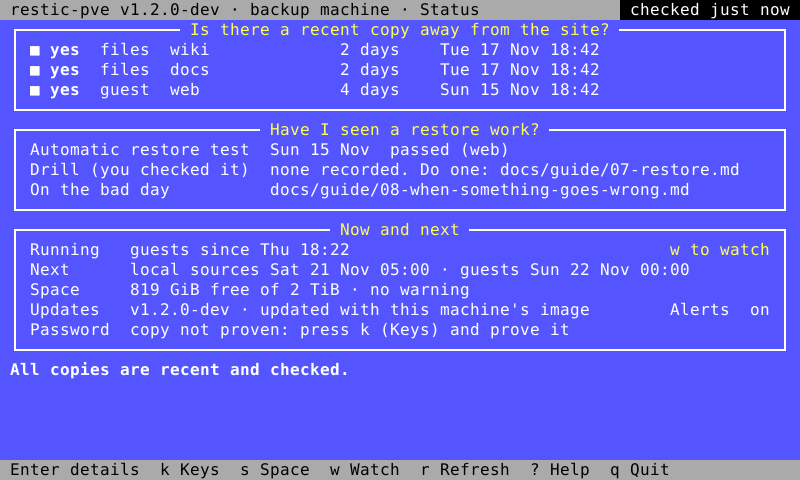
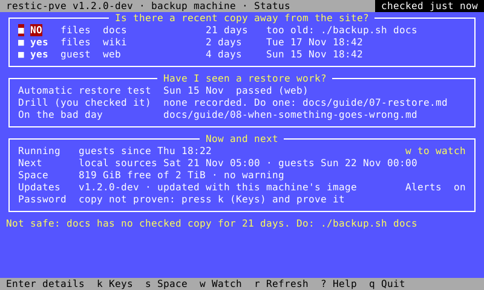
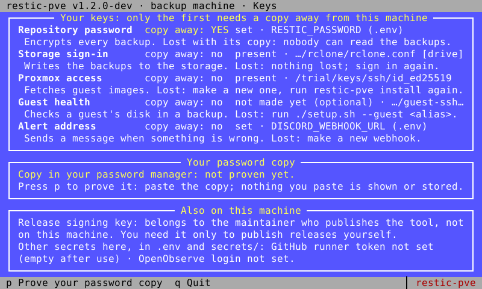
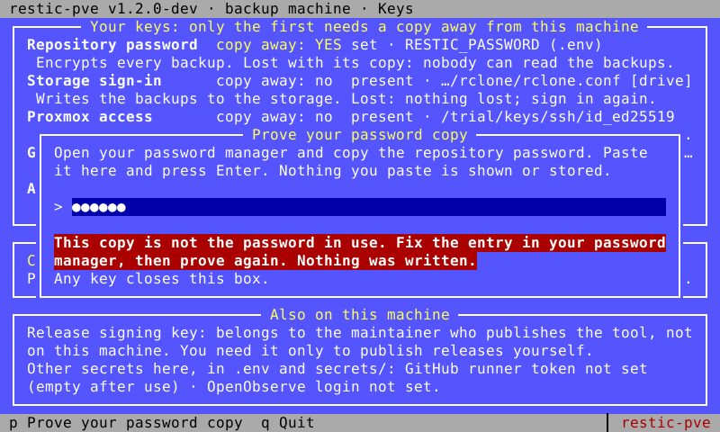
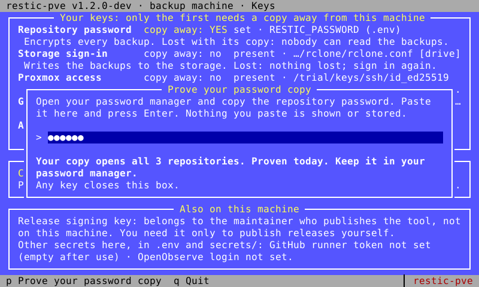
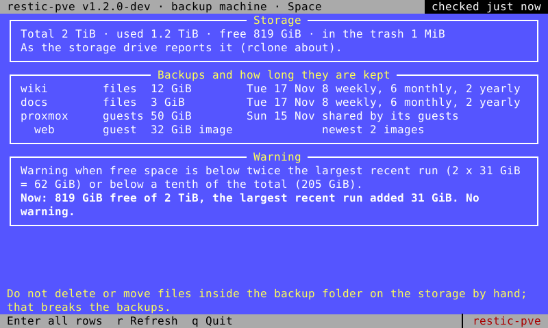
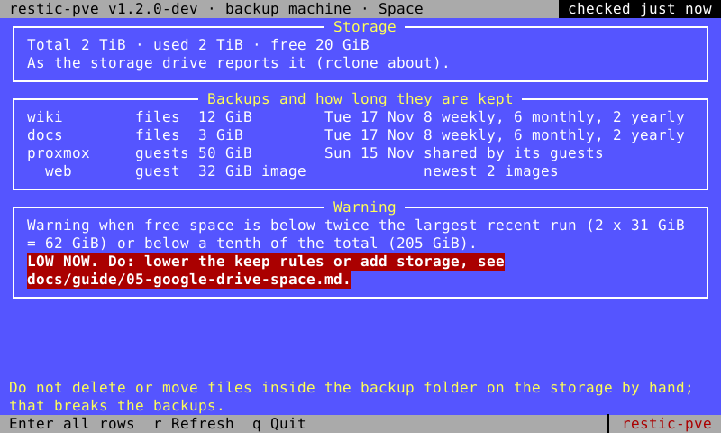
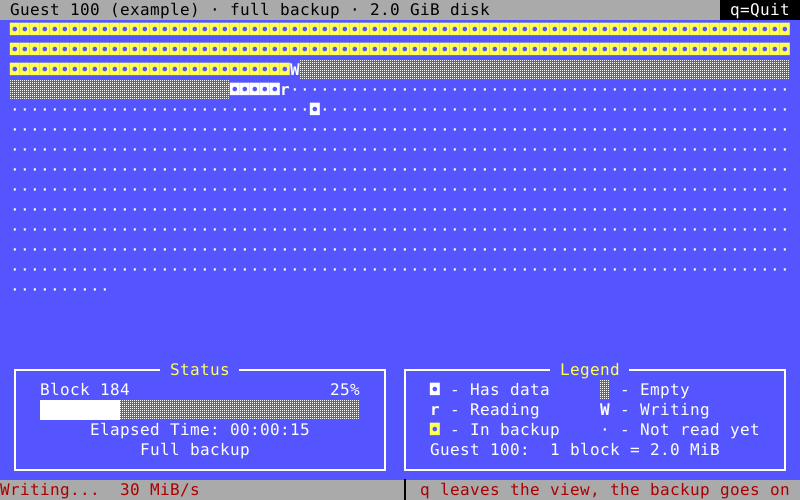
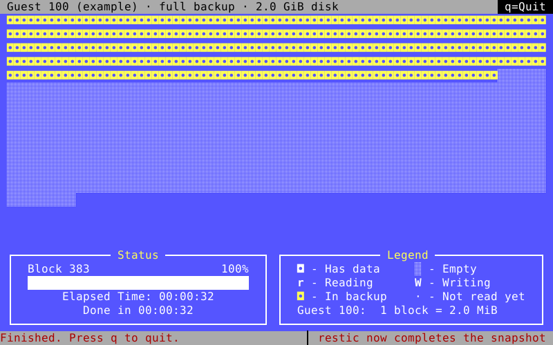

# restic-pve on the backup machine

For an admin who looks after the backups on the backup machine and wants to use `status`,
`keys`, `space` and `watch`. Each section is one question and the command that answers it.

## What is here and what is not

On the backup machine this repository provides five commands: `status`, `keys`, `space`,
`watch` and `stream`. They read the backup machine's files and its storage; none of them changes
a backup. The rest of the backup machine is control code that is not published yet: it holds
the schedule, calls restic and rclone, writes the records these screens read, and provides the
setup. Making the backup machine installable from this repository is the next stage (see the
[README](../README.md#state-and-roadmap)).

So on a machine without that control code, these screens have nothing to show yet. The paths
some screens name, such as `docs/guide/07-restore.md` or `./backup.sh`, belong to the control
code as well.

## What the commands need

The tool counts as the backup machine when `RESTIC_PVE_STATE` is set. Each command says which
variable is missing and gives an example (exit 78). In the container image of the control code
these are set already.

| Variable | Needed by | Example |
|---|---|---|
| `RESTIC_PVE_STATE` | all | `/state` |
| `BACKUP_CONFIG` | status, space; keys reads it if set | `/app/config/backup.toml` |
| `RESTIC_PASSWORD` | status, space (not `space --check`) | from `.env` |
| `RESTIC_PVE_KEYS` | keys | `/config` |
| `RESTIC_PVE_START_HINT` | status, watch | `'./backup.sh <source>'` |
| `RCLONE_CONFIG` | read by rclone; keys shows the section name | |

The full list, with what each command reads: [reference/commands.md](reference/commands.md).
The screens read the storage at most every six hours, or when you press `r`, at low CPU and I/O
priority. Looking never changes anything.

## Is there a recent copy away from the site?

```sh
restic-pve status
```



Three boxes answer three questions: is there a recent copy away from the site, have I seen a
restore work, and what runs now and next. The line under them is the verdict.



A source that is not safe comes first, in red, and the bottom line gives the one command that
fixes it. Enter lists all rows, `k`, `s` and `w` open keys, space and watch, `r` reads the
storage again, `?` shows the help.

In scripts, `restic-pve status --plain` prints one fact per line and exits 0 when every source
and guest is safe, 1 when one is not or is not known.

## Which keys matter, and is my password copy right?

```sh
restic-pve keys
```



Every key on this machine, by presence only: no value is shown. Only the repository password
needs a copy away from this machine; losing both it and the copy means nobody can read the
backups. The release signing key is not on this machine; it belongs to the maintainer.

Press `p` to prove the copy in your password manager. Paste it and press Enter; the field shows
the same six dots whatever you paste.



A wrong copy is refused, and nothing is written.



The right copy opens every repository, and the status screen then shows the proof date.

## Is there enough space on the storage?

```sh
restic-pve space
```



Storage as the drive reports it, the size of each backup and its keep rules, and the warning
rule with today's numbers.



The warning holds when the free space is below twice the largest recent run, or below a tenth of
the total. `restic-pve space --check` prints that verdict as one line (exit 0 no warning, 1
warning, 2 not known); the control code runs it after each backup.

## What runs right now?

```sh
restic-pve watch
```



The guest backup that runs now, as blocks. `r` marks the part being read from the Proxmox host,
`W` data going into the backup, and the yellow run what is already in it. Nothing is animated:
when the backup waits, the picture waits. `q` leaves the view, and the backup goes on.



At the end the run is solid and the status box says how long it took; restic then completes its
snapshot. For a local source (files, not a guest) watch shows its progress instead. When nothing
runs, it names the command that starts a backup. It closes itself ten minutes after the last
running backup. `restic-pve watch --once` prints one line instead.

[Back to the index](README.md)
