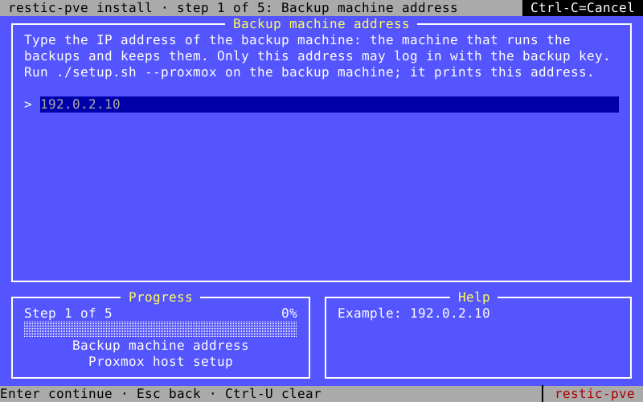
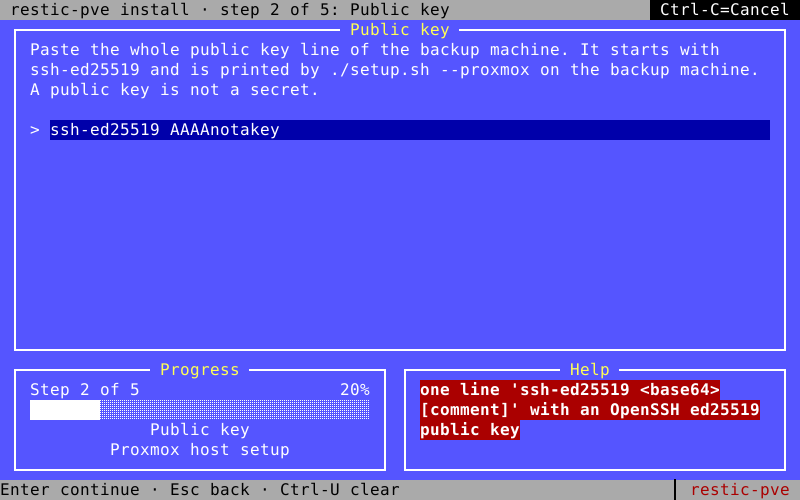
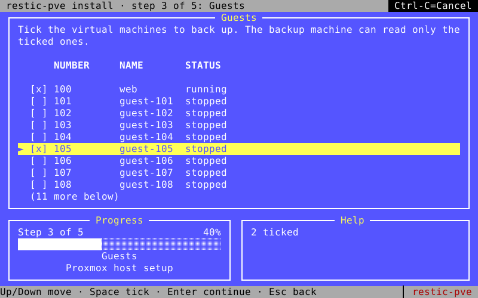
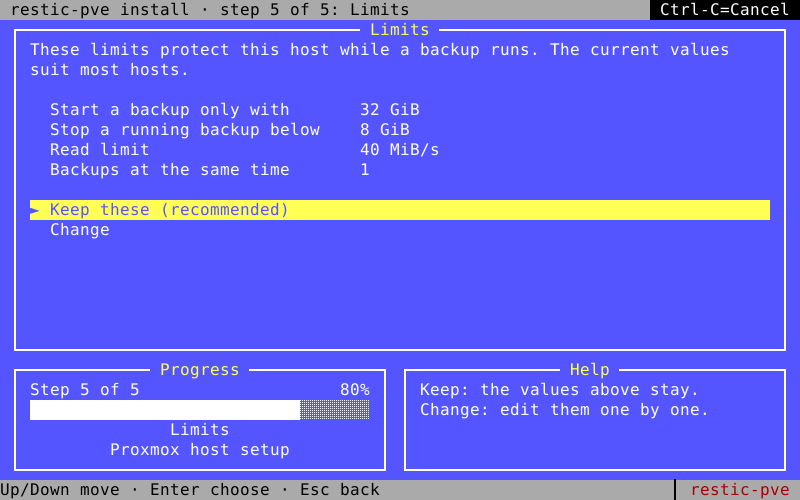
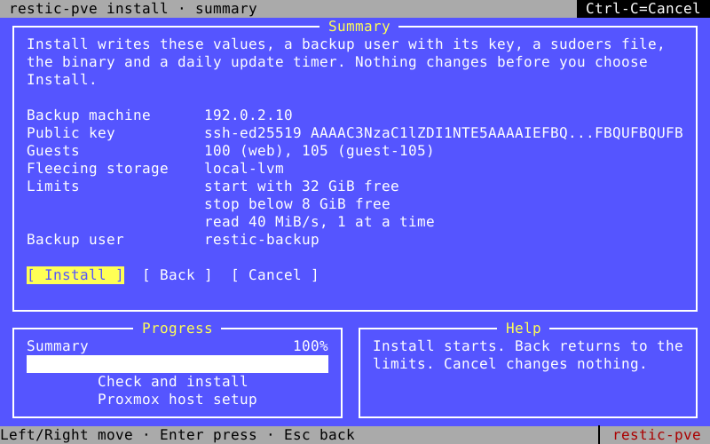

# Set up restic-pve on a Proxmox VE host

For an admin who puts `restic-pve` on a Proxmox VE host for the first time. It takes about five
minutes, and every step can be undone with `restic-pve uninstall`.

## What it does on the host

`restic-pve` lets one backup machine copy your virtual machines off this host. The backup
machine logs in over SSH with one key, and that key can do one thing: ask `restic-pve` for an
image of a guest you allowed. A running guest keeps running while it is copied. Once a day the
tool checks for a newer release and installs it only when it is signed.

It does not store backups, keep old versions or restore anything; the backup machine does that.
The backup machine gets no shell, no root access and no access to guests you did not tick. Your
guests, storages, vzdump jobs and Proxmox settings stay as they are.

What it writes, and how to remove it: [host.md](host.md).

## Before you start

You need two values from the backup machine:

1. its address, for example `192.0.2.10`;
2. its public key, one line that starts with `ssh-ed25519`, for example
   `ssh-ed25519 AAAAC3NzaC1lZDI1NTE5AAAAI...`. Copy the whole line. A public key is not a secret.

On a backup machine that runs the control code, `./setup.sh --proxmox` prints both. That command
belongs to the control code, which is not published yet (see the
[README](../README.md#state-and-roadmap)); the form names it because that is where the values come
from today.

You also need a root shell on the Proxmox VE host.

## Install

Paste this line into the root shell on the Proxmox VE host:

```
curl -fsSLo /usr/local/sbin/restic-pve https://github.com/norandom/restic-pve/releases/latest/download/restic-pve-linux-amd64 && chmod 755 /usr/local/sbin/restic-pve && restic-pve install
```

To check the download before you run it, see [host.md](host.md#check-a-download).

A form opens and fills the terminal. The grey bar on top says which step you are on. The main box
has the explanation and the field or list. Below it, Progress shows how far you are and Help
shows an example or the rule for the current field. The grey bar at the bottom lists the keys.
There are five steps and a summary. On every screen:

- Enter goes on when the value is valid; otherwise the rule shows in the Help box and you stay.
- Esc (or Shift-Tab) goes one screen back and keeps what you entered.
- Ctrl-C cancels, and nothing is changed.

Grey text in an empty field is only an example and is never used as the value. The yellow bar
shows where you are in a list.

### 1. Backup machine address



Type the address of the backup machine. Backspace deletes, Ctrl-U clears the field.

### 2. Public key



Paste the whole line, including `ssh-ed25519`. If the copied line ends with a line break, pasting
it also presses Enter. A long key shows only its end. In the picture the pasted value is not a
real key, so the Help box shows the rule and the form stays on this step.

### 3. Guests



Move with the arrow keys (or j and k), tick or untick with Space, then press Enter. Tick at least
one. A long list scrolls, and the Help box counts the ticked guests.

### 4. Fleecing storage

No capture of this screen yet; its main box looks like this:

```
 ┌───────────────────────────── Fleecing storage ─────────────────────────────┐
 │ Choose where this host keeps temporary data while a running guest is read, │
 │ so the guest is not slowed down (fleecing). The usual choice is the one    │
 │ with the most free space on fast disks.                                    │
 │                                                                            │
 │       NAME       TYPE        FREE GiB                                      │
 │                                                                            │
 │ ► (*) local      dir               77                                      │
 │   ( ) local-lvm  lvmthin          819                                      │
```

Move to the storage and press Enter. The list holds the active storages of `pvesm status`.

### 5. Limits



Press Enter to keep them. Change shows the four values as fields, and the Help box gives the
allowed range of the field you are on. Move between them with the arrow keys and press Enter
after each.

### Summary



Check the values. Install is selected (yellow); Enter installs. Left and Right (or Tab) move to
Back or Cancel.

## What success looks like

The form closes and the host prints one line per file, then:

```
written   /etc/restic-pve.conf
...
restic-pve v1.2.3 ready: user restic-backup, key accepted from 192.0.2.10, guests: 100
This host updates restic-pve daily to the latest signed release (restic-pve-update.timer).
```

The backup machine can now ask for images of the ticked guests.

## Without the form

`restic-pve install --plain`, or a terminal smaller than 60 by 20, asks the same questions line by
line, with an example for the address and the key. Enter takes the value in brackets. The guests
are typed as VM numbers separated by spaces or commas. At the end it asks
`Install with these values? [y/N]`; only `y` installs.

## Later

- To change a value (another guest, a new key, other limits), run `restic-pve install` again. The
  form starts with the current values; change what you need and press Enter on the rest.
- Updates run once a day by themselves. To update now: `restic-pve update`.
- To remove everything: `restic-pve uninstall`.

When a message appears that you do not understand: [troubleshooting.md](troubleshooting.md).

[Back to the index](README.md)
