# The screens

For an admin who wants to recognise a screen and know which keys work on it. Every screen, with
the machine it runs on and the command that opens it.

All screens share one look, after the DOS-era disk tools: a blue full screen, framed boxes with
yellow titles, a grey title bar on top and a grey key bar at the bottom. Without a terminal, on a
terminal smaller than 60 by 20, with `TERM=dumb` or with `--plain`, the same facts come as plain
lines; `NO_COLOR` keeps the layout and drops the colours. The rules behind the look are in
[reference/house-style.md](reference/house-style.md).

## On the Proxmox host

### Install form: `restic-pve install`

Keys on every step: Enter continue, Esc (or Shift-Tab) back, Ctrl-C cancel. In text fields
Ctrl-U clears; in lists Up/Down (or j and k) move and Space ticks; on the summary Left/Right (or
Tab) move between the buttons. Plain questions: `restic-pve install --plain`.

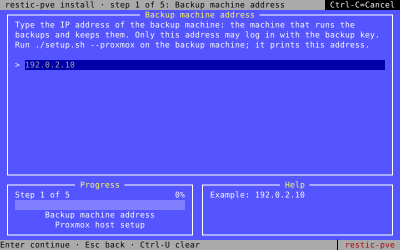

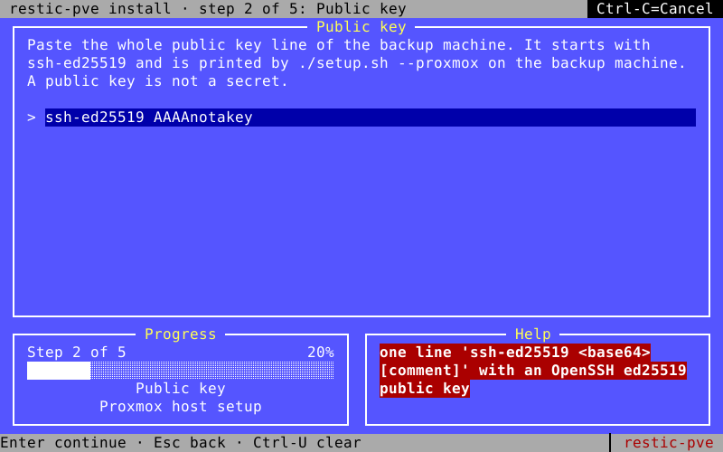

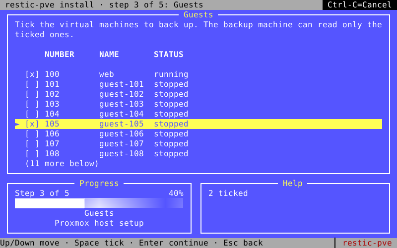

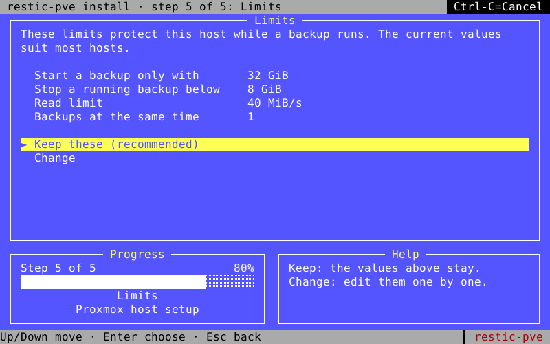

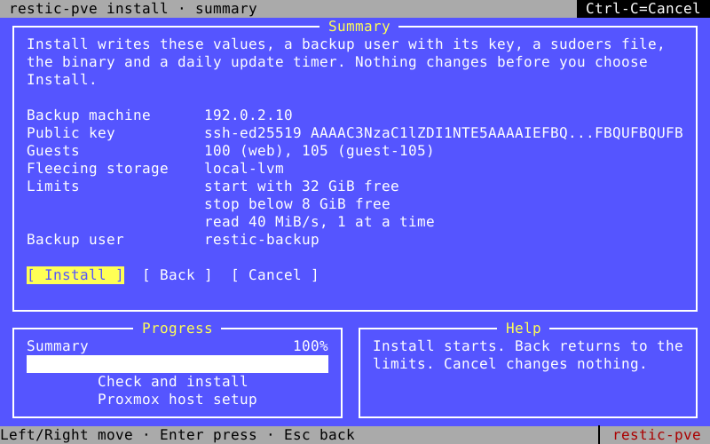

Step 4, the fleecing storage, has no capture yet; [onboarding.md](onboarding.md#4-fleecing-storage)
shows its text.

## On the backup machine

### Status: `restic-pve status`

Keys: Enter details, `k` keys, `s` space, `w` watch, `r` read the storage again, `?` help, `q`
quit. Plain lines: `--plain`.

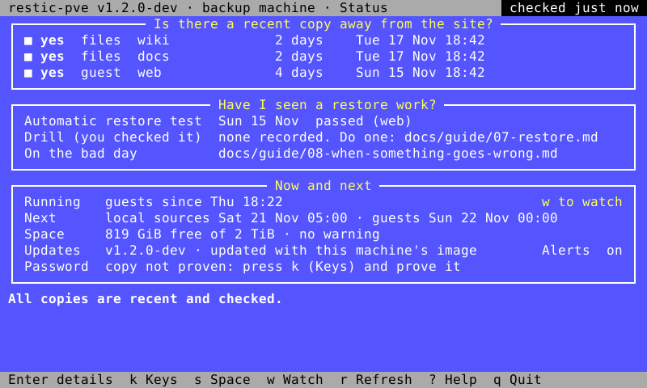

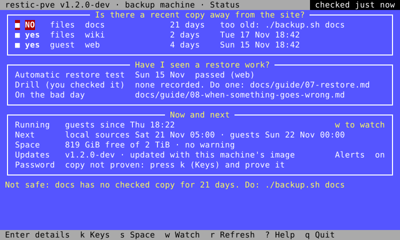

When a guest reads only its changed blocks, a box "Guests that read only changes" under the
copies shows two lines per guest: the kind of the last run (`changes`, `full read` or
`full check`) with what was read from the Proxmox host and skipped as unchanged, for example
`changes: read 1.2 GiB, skipped 123.8 GiB (unchanged)`, then its time and the last full check,
`full check: ok 2026-11-27`. A guest whose full check found a difference comes first, with the
fault in the error colours and the command that clears it. The copies keep their rows: when
there is no room, the title says how many guests show and Enter lists them all. In the plain
lines these are the `reads` and `fault` lines.

### Keys: `restic-pve keys`

Keys: `p` prove your password copy, `q` quit (or back to status). Any key closes the proof box.
Plain lines: `--plain`.

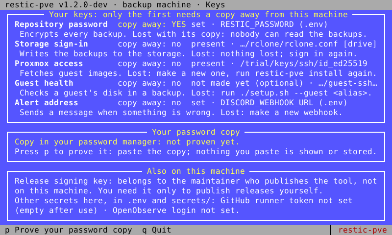

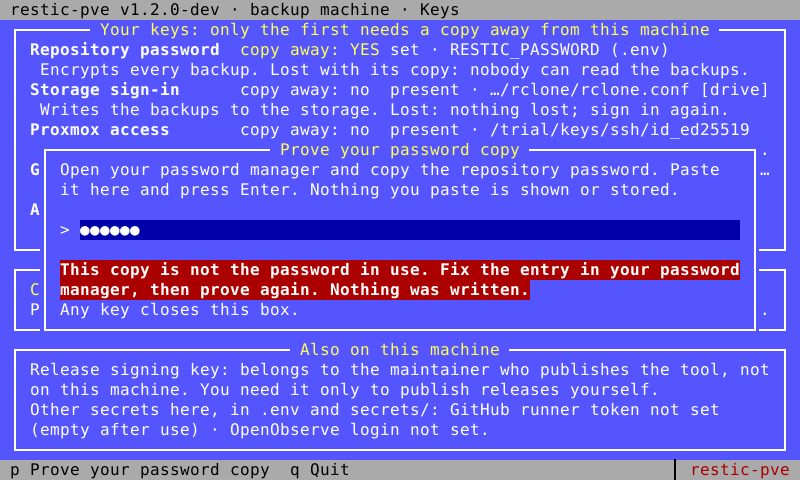

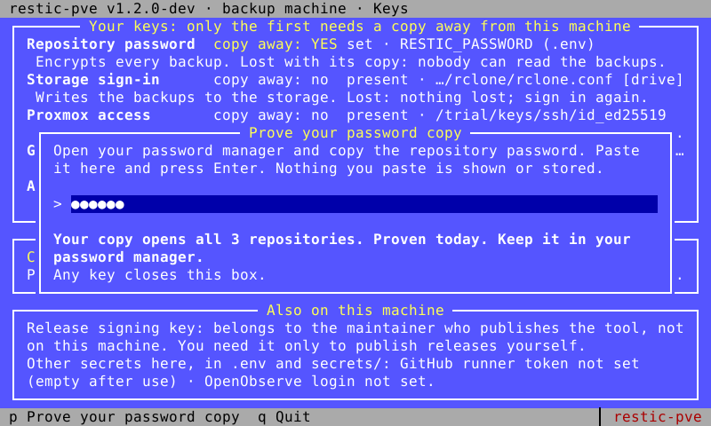

### Space: `restic-pve space`

Keys: Enter all rows, `r` read the storage again, `q` quit (or back to status). Plain lines:
`--plain`; one line for scripts: `--check`.

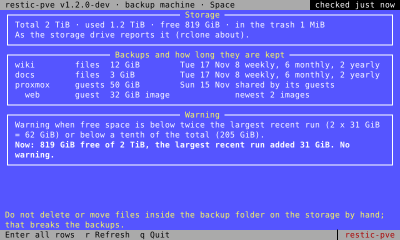

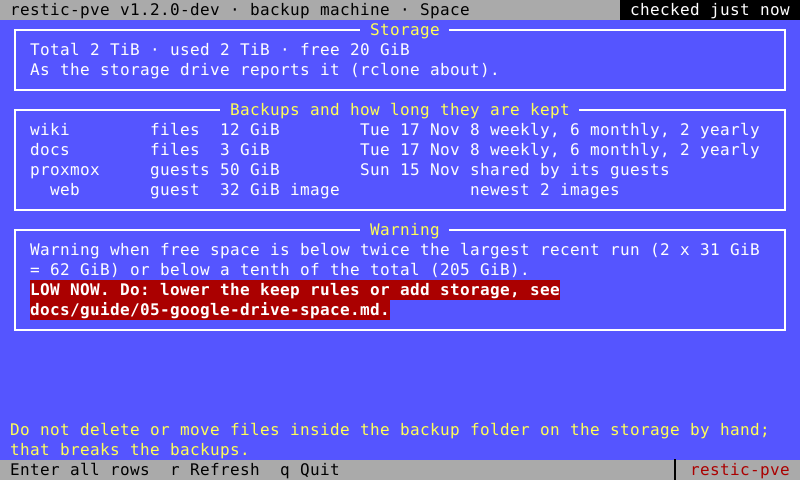

When a guest reads only changes, the Storage box adds the working space of those runs on this
machine: `Pieces working space: 1 GiB in total (web 1 GiB, db 16 KiB) in /state/pieces, 812 GiB
free`. It counts what the pieces in flight take on disk; the placeholders of unchanged pieces
take nothing. In the plain lines it is the `work` line.

### Watch: `restic-pve watch`

Keys: `q` leaves the view; the backup goes on. One plain line: `--once`.

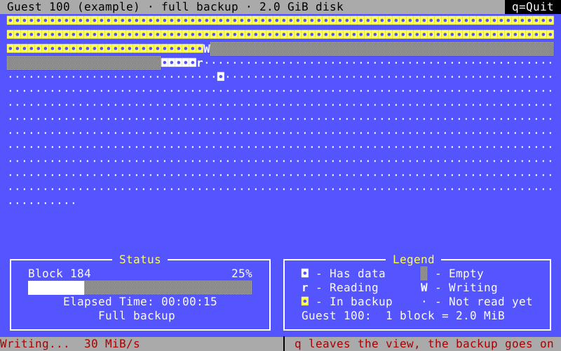

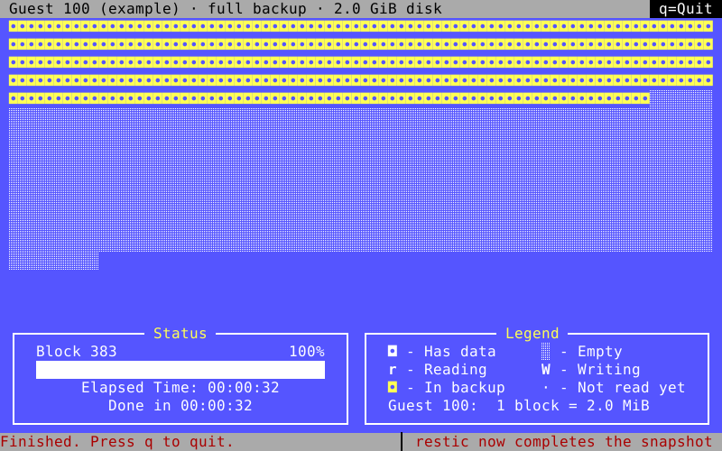

## On any machine

### Demo: `restic-pve demo pack`

A simulated run on a made-up 125 GiB disk; it reads no data. `restic-pve demo pack incremental`
shows a run where most blocks did not change; `restic-pve demo` without `pack` colours the
blocks in place. Keys: `q` (or Ctrl-C) quits.

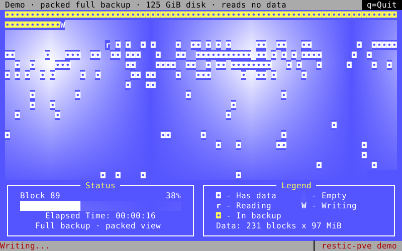

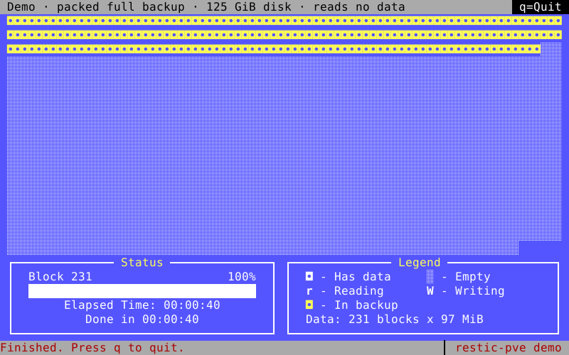

Status, keys and space close themselves after ten minutes without a key press; watch closes ten
minutes after the last running backup.

[Back to the index](README.md)
