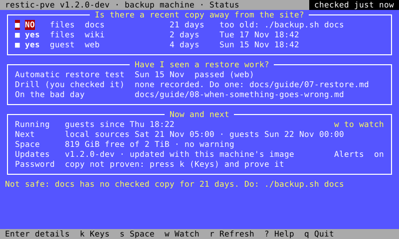

# When something goes wrong

For an admin who has a message from `restic-pve` in front of him and wants to know what to do.
Find the message (or its start) below. When a message says "nothing changed" or "Nothing was
changed", fix the cause and run the same command again.

## Wrong machine

| Message starts with | What to do |
|---|---|
| `restic-pve install is for the Proxmox host; this is the backup machine.` (or `update`, `uninstall`, `request`) | Run it in a root shell on the Proxmox host. Exit 64. |
| `restic-pve status is for the backup machine; this is the Proxmox host.` (or `keys`, `space`, `watch`, `stream`) | Run it on the backup machine. A Proxmox host never runs a backup-machine command. Exit 64. |
| `restic-pve status is for the backup machine, and RESTIC_PVE_STATE is not set.` | Set `RESTIC_PVE_STATE` to the backup machine's state folder, for example `RESTIC_PVE_STATE=/state`. Exit 78. |

`restic-pve version` shows which machine the tool thinks it is on, on a terminal: for example
`role: backup machine`. The Proxmox host is recognised by the folder `/etc/pve` or the file
`/etc/restic-pve.conf`.

## On the Proxmox host

| Message | What to do |
|---|---|
| `restic-pve: install must run as root on the Proxmox VE host` | Use a root shell (`sudo -i`). The same holds for `uninstall` and `update`. |
| `restic-pve: qm not found in /usr/sbin:/usr/bin:/sbin:/bin: this is not a Proxmox VE host; nothing changed` | Run it on the Proxmox VE host itself, not inside a guest. |
| `restic-pve: qm list shows no guests on this host; nothing changed` | Create the guest first. In a cluster, install on the node that holds the guest. |
| `restic-pve: pvesm status shows no active storage for fleecing; nothing changed` | Fix the storage in Proxmox until `pvesm status` shows it active. |
| `one line 'ssh-ed25519 <base64> [comment]' with an OpenSSH ed25519 public key` | Copy the whole key line again, starting with `ssh-ed25519`. Other key types, such as `ssh-rsa`, are not accepted. |
| `restic-pve: no terminal to ask on; nothing changed` | Run `restic-pve install` from an interactive root shell, not from a script or a pipe. |
| `restic-pve: uninstall refused: a dump is running (lock held); nothing changed` | Wait for the backup to finish, then run it again. Exit 75. |
| `restic-pve: update failed: ...` | The installed binary is unchanged. `systemctl status restic-pve-update.service` shows the same reason for the daily run. |
| `restic-pve: update failed: SHA256SUMS: signature does not match any release key` | Do not install that file. Check the release page; see [release-signing.md](release-signing.md#a-lost-or-leaked-key). |
| `restic-pve: update failed: latest release v1.2.0 is older than the installed v1.2.1; nothing changed` | Nothing to do: the tool never goes back to an older release. |

A guest missing from the install list: the list is `qm list` on this host, so a guest on
another node must be set up on that node. A storage missing from the list: only active storages
of `pvesm status` are shown.

The form shows frames of `+`, `-` and `|`: the terminal's language setting is not UTF-8 (for
example `LANG=C`). It works the same. No form at all, only questions: the terminal is smaller
than 60 by 20, or `TERM` is `dumb`.

### Messages the backup machine passes on

These come from `restic-pve request` on the host and show up in the backup machine's logs.

| Message | What to do |
|---|---|
| `restic-pve: refused: VM 105 is not on the allow list` | Tick the guest with `restic-pve install` on the host. Exit 64. |
| `restic-pve: error: busy: another dump is running on this host` | Another guest is being sent. The stream marks this as transient, so a later try can work. Exit 75. |
| `restic-pve: error: fleecing storage local has 20 GiB free, below FLEECING_MIN_FREE_GIB=32; dump not started` | Free space on that storage, or pick another one with `restic-pve install`. Exit 73. |
| `restic-pve: error: /etc/restic-pve.conf missing (run restic-pve install again)` | Run `restic-pve install` again. Exit 78. |

## On the backup machine

| Message | What to do |
|---|---|
| `BACKUP_CONFIG is not set: it is the path of backup.toml, ...` (or another variable) | Set the variable it names; the message gives an example. Exit 78. See [backup-machine.md](backup-machine.md#what-the-commands-need). |
| `restic-pve watch: RESTIC_PVE_START_HINT is not set.` | Set it to the command that starts a backup on this machine, for example `RESTIC_PVE_START_HINT='./backup.sh <source>'`. Exit 78. |
| `restic-pve status: no usable terminal (...); run it with --plain` | Run it with `--plain`, or from a real terminal. |
| `The screen closed itself after 10 minutes without a key press (or a running backup). Nothing was changed.` | Nothing to do; open it again. |
| `This copy is not the password in use. Fix the entry in your password manager, then prove again. Nothing was written.` | Your saved copy is wrong. Correct it in the password manager now, while the password in use still works, and prove again with `p` on the keys screen. |
| `restic-pve demo: the demo needs a terminal` | Run the demo in an interactive terminal, not through a pipe. |

On the status screen, a red `NO` and the bottom line are the place to look first: the line names
the source and the command that fixes it.

## Guest backup errors (stream exit codes)

The backup machine reports these from `restic-pve stream backup`. The full list is in
[reference/stream-contract.md](reference/stream-contract.md#exit-codes-and-stderr).

| Exit | Meaning | What to do |
|---|---|---|
| 5 | vzdump reported that fleecing is not active | Check the fleecing storage on the host (`pvesm status`). |
| 6 | the source failed (ssh or vzdump, or a cut stream) | Look at the vzdump lines in the log; exit 75 from the host (busy) is marked transient. |
| 7 | local I/O, or the RAM cap of the reorder buffer is used up | Raise `--ram-mib`, or lower `MAX_WORKERS` with `restic-pve install` on the host. |
| 10 | the guest's file system reported an error while it was frozen | Check the guest (fsck). The backup was not written. |

[Back to the index](README.md)
